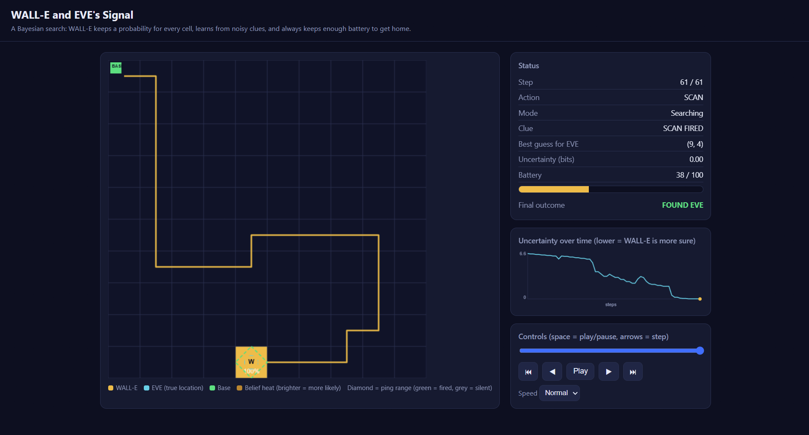

# WALL-E and EVE's Signal

A search simulation. WALL-E is a robot looking for a hidden target, EVE, on a
10x10 grid. WALL-E cannot see EVE. It only gets **noisy clues**, so it has to
reason with probabilities, choose its actions carefully, and always keep
enough battery to **return to its charging base safely**.

It combines three ideas:

| Idea | What it means here |
|---|---|
| **Bayesian belief** | WALL-E keeps a probability for every cell ("is EVE here?") and updates it after every clue using Bayes' rule. |
| **POMDP-style decision making** | WALL-E cannot see the true state (EVE's location), so it picks actions based on its *belief*, choosing the action with the best expected information per unit of battery. |
| **Safe return** | A hard rule: WALL-E never takes an action unless the battery would still cover the trip home plus a safety margin. |



## Setup

You need Python 3.10 or newer.

Open the project folder in VS Code, open the terminal (`Ctrl + ``), then:

```
python -m venv .venv
.venv\Scripts\activate          # Windows
# source .venv/bin/activate     # macOS / Linux
pip install -r requirements.txt
```

Only three packages are used: `numpy`, `pyyaml`, `pytest`.

## Run

```
python run_simulation.py
```

This runs one search and creates:

- `outputs/trajectory.json` - every step: position, action, clue, battery, and the full belief grid
- `outputs/visualization.html` - **open this file in your browser** to watch the run

Other useful commands:

```
python run_simulation.py --seed 12      # different hidden EVE location
python run_simulation.py --batch 100    # success statistics over 100 runs
python -m wall_e.visualize              # rebuild the HTML from trajectory.json
pytest -v                               # run all tests
```

## What you see in the visualization

- The 10x10 grid, with the **belief heatmap** (brighter = WALL-E thinks EVE is more likely there) and percentages in likely cells
- WALL-E's **path** drawn step by step, the **base**, and EVE's **true location**
- A **diamond** showing the ping range on every ping (green = fired, grey = silent)
- A **battery bar** and a live **uncertainty chart** that falls as WALL-E learns
- Play / pause / step / scrub controls (keyboard: space and arrow keys)

## How it works

1. **Start:** WALL-E is at the base. Belief is uniform (1% per cell).
2. **Each step**, WALL-E picks one of: move (up/down/left/right), **ping**, or **scan**.
   - **Ping** (cost 1): a noisy "EVE is within 3 steps" clue. It can fire when EVE is near (80%) and also falsely when she is far (10%).
   - **Scan** (cost 2): checks only WALL-E's own cell. If EVE is there it finds her 90% of the time.
3. **Update:** the clue is turned into a likelihood for each cell and the belief is updated with Bayes' rule.
4. **Decide:** the policy scores each safe action by *expected uncertainty reduction (plus a bonus for the chance of finding EVE) per battery unit*, and takes the best.
5. **Safe return:** if no safe sensing action is left, WALL-E walks straight home and stops.
6. **End:** EVE found, back at base, or time out.

All numbers (costs, noise, battery, grid size) are in `config.yaml`. Change them
and re-run.

## Project structure

```
config.yaml            all settings
run_simulation.py      entry point (single run or --batch)
wall_e/
  models.py            actions, clue types, statuses, observation
  config.py            loads + validates YAML/JSON settings
  environment.py       the grid world: hidden EVE, battery, clock, noisy sensors
  belief.py            Bayesian belief and sensor likelihood
  policy.py            decision rule + safe-return rule
  simulation.py        runs an episode and records the trajectory
  visualize.py         builds the self-contained HTML animation
tests/                 35 tests (config, environment, belief, policy, simulation)
outputs/               generated files (trajectory.json, visualization.html)
DEMO_GUIDE.md          plain-language explanation and likely questions
```

## Results

With the default `config.yaml`, over 300 seeded runs (`python run_simulation.py --batch 300`):
EVE found in about **94%** of runs, never out of battery, average about 48 steps.
In the remaining runs, WALL-E returned safely to base because the battery ran out
before the search finished.

## Known limitations

- The policy is **greedy** (it looks one step ahead). It is not an optimal POMDP solver.
- EVE stays still; the sensor model is a simple noisy "nearby" check.
- Pings are assumed independent of each other. Real sensors can have correlated errors.
- The ping range is a diamond (Manhattan distance), not a true circle.
- Battery size matters a lot: with 70 instead of 100, the success rate falls to about 67%.
